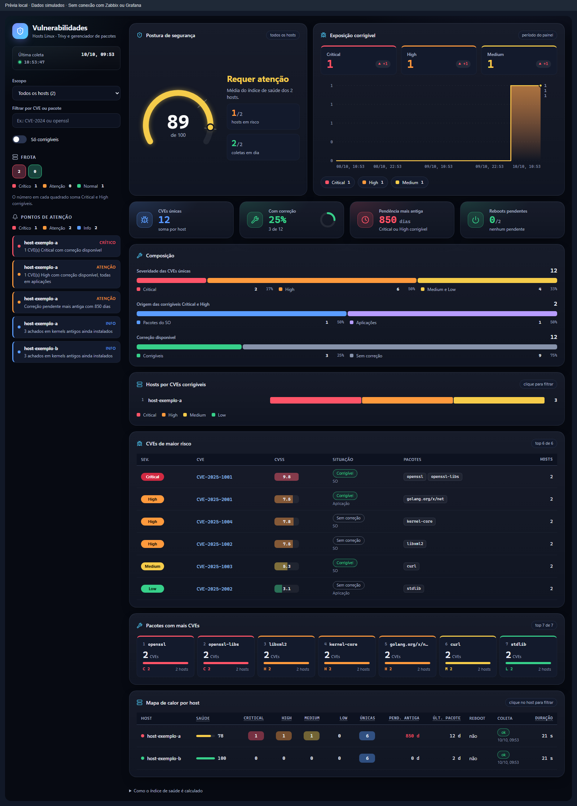
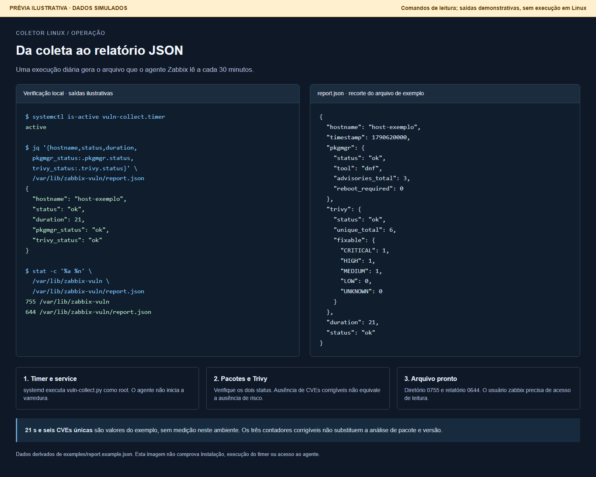
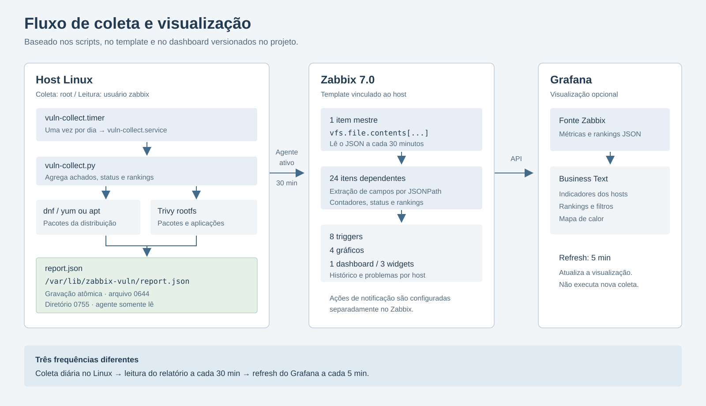

# Galeria da integração

As imagens apresentam o dashboard Grafana, o template Zabbix e o fluxo de coleta. As prévias usam dados simulados. Elas não comprovam instalação, importação ou comunicação com serviços reais.

| Imagem | Origem |
|---|---|
| Grafana | Código do painel Business Text executado localmente com dados simulados |
| Zabbix: dashboard do host | Interface aproximada, com os três widgets definidos no YAML |
| Zabbix: Latest data | Interface aproximada, com 24 itens dependentes do template |
| Coleta e relatório | Comandos de leitura com saídas ilustrativas e recorte do relatório de exemplo |
| Fluxo de coleta | Diagrama baseado nos scripts, template e dashboard versionados |

## Grafana

O código do painel foi executado localmente para dois hosts simulados. A imagem não resulta de consultas à API Zabbix. Consulte [grafana.md](grafana.md) para configurar a fonte de dados e importar o dashboard.

## Zabbix: dashboard do host

Os nomes e a disposição dos três widgets seguem [template_linux_vulnerabilidades.yaml](../zabbix/template_linux_vulnerabilidades.yaml): um widget de problemas com `scope: security` e dois gráficos. O layout do frontend é aproximado.

Os valores finais vêm de [report.example.json](../examples/report.example.json). Os seis pontos anteriores, os horários dos eventos e a evolução dos gráficos são fictícios. Eles não representam medições ou resultados de remediação.

Nesse exemplo, os limites padrão permitem dois problemas de segurança: uma CVE Critical corrigível em pacote do SO e um advisory Critical pendente. O contador de High corrigíveis em aplicações aparece no gráfico, mas não tem trigger específica no template.

Consulte [zabbix.md](zabbix.md) para importação, vínculo, macros e interpretação. A documentação oficial do Zabbix 7.0 descreve os widgets [Problems](https://www.zabbix.com/documentation/7.0/en/manual/web_interface/frontend_sections/dashboards/widgets/problems) e [Graph](https://www.zabbix.com/documentation/7.0/en/manual/web_interface/frontend_sections/dashboards/widgets/graph).

## Zabbix: Latest data

A imagem mostra uma seleção dos 25 itens dependentes. Os nomes vêm do template e os valores são extraídos pelos respectivos JSONPaths. O timestamp usa UTC. O value map de reboot converte `0` em `Não`.

Os tempos de **Last check** são ilustrativos. O intervalo de leitura do item mestre é `30m`, mas itens com descarte de valores iguais podem ter um horário anterior no histórico. Consulte a [documentação oficial de Latest data](https://www.zabbix.com/documentation/7.0/en/manual/web_interface/frontend_sections/monitoring/latest_data) e o procedimento de [validação](zabbix.md#validar).

## Coleta e relatório

As saídas não foram obtidas em um host Linux nesta sessão. `active`, as permissões e o formato de saída demonstram verificações descritas na documentação. Os valores do JSON vêm do arquivo de exemplo.

Os comandos mostrados consultam estado, relatório e permissões. Consulte [operacao.md](operacao.md) para executar as verificações no host real e [instalacao.md](instalacao.md) para instalar o coletor.

## Fluxo de coleta

O diagrama diferencia as três frequências. A atualização do Grafana não executa a varredura novamente. Os limites de CPU, memória e IO aplicam-se ao service de coleta. Consulte [arquitetura.md](arquitetura.md).

## Substituir por capturas do ambiente

1. Confirme os dados e abra as telas correspondentes conforme os guias de Zabbix e Grafana.
2. Oculte nomes internos de hosts, endereços, usuários e informações da organização que não devem aparecer no repositório público.
3. Salve a captura nos caminhos usados nesta página. Preserve texto legível e evite incluir credenciais ou abas de configuração com dados sensíveis.
4. Atualize a legenda e a coluna **Origem**. Informe versão e contexto verificados, distinguindo captura real de prévia ilustrativa.

O arquivo SVG é editável e inclui título e descrição acessíveis. As imagens PNG têm texto alternativo nos guias e nesta galeria.
